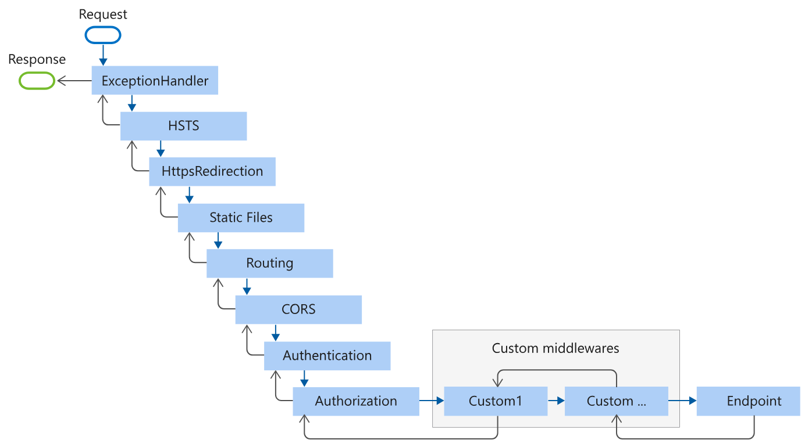

# Setting Up Pipeline

Learn how to set upp builder services and middlewares in `Program.cs`.

## Table of Contents

- [1. Middlewares](#middlewares)
    - [1.1. Middleware order](#middleware-order)
    - [1.2. Custom middlewares to pipeline](#custom-middlewares-to-pipeline)
    - [1.3. Environment-specific middlewares](#environment-specific-middlewares)
- [2. Build services](#build-services)
    - [2.1. Adding dependencies](#adding-dependencies)
    - [2.2. Adding exception handlers](#adding-exception-handlers)
    - [2.2. Adding CORS policy](#adding-cors-policy)

## 1. Middlewares

Middlewares are code in the app pipeline that may read or modify:

- a HTTP request *before* it reaches an endpoint. 
- a HTTP response *after* it leaves an endpoint. 

### 1.1. Middleware order

- HTTP requests will pass through the pipeline in an ascending order; from the 
first added middleware to the last added middleware.
- HTTP responses will pass through the pipeline in in reverse order; from the 
last added middleware to the first added middleware.

> 
> This is a typical ASP.NET MVC pipeline (for details, see 
[Middleware order🔗‍️](https://learn.microsoft.com/en-us/aspnet/core/fundamentals/middleware/?view=aspnetcore-10.0#middleware-order)):

Our middleware pipeline looks like this.

```csharp
var app = builder.Build();

app.UseExceptionHandler();
app.UseHsts();
app.UseHttpsRedirection();
app.UseCors();
app.UseAuthentication();
app.UseAuthorization();

app.Run();
```

- The `UseExceptionHandler()` middleware is a special way of handling exceptions.
See [Adding exception handlers](#adding-exception-handlers).
- The `UseHsts()` and `HttpsRedirection()` middlewares are required for HTTPS.
    - `UseHsts()` sets all HTTP responses to have the [`Strict-Transport-Security`🔗‍️] 
    response header which tells the client browser to only use HTTPS.
    - `HttpsRedirection()` redirects incoming HTTP request to use HTTPS.
- The `UseCors()`, `UseAuthentication()`, and `UseAuthorization()` middlewares 
are required and **must** be added next to each other.
    - `UseCors()` sets server CORS policy. 
    See [Adding CORS policy](#adding-cors-policy).
    - `UseAuthentication()` allows checking if user is logged in.
    - `UseAuthorization()` allows checking if user has valid roles. 

[`Strict-Transport-Security`🔗‍️]: https://developer.mozilla.org/en-US/docs/Web/HTTP/Reference/Headers/Strict-Transport-Security

### 1.2. Custom middlewares to pipeline

We can add our custom middleware classes into the pipeline with `Use()` or
`UseMiddleware()`. 

> **WARNING!**
> Be careful where in the middleware pipeline the custom middleware is added.
Some middlewares **MUST** be set up in a specific order.

- Middlewares that catches and handles exception **should** be added first. 
    - Do not add custom exception handler middlewares with `Use()` or
`UseMiddleware()`. Instead add your class as a service. 
See [Adding exception handlers](#adding-exception-handlers).

- Middlewares that reads a HTTP requests URL **must** be added *after* 
`UseHsts()` and `UseHttpsRedirection()`.
- Middlewares that sets cookie policies **must** be added *before* 
`UseAuthentication()`.

### 1.3. Environment-specific middlewares

If we only want middlewares in either the `Development` or the `Production` 
environment, we can check with `IsDevelopment()` and `IsProduction()`.

```csharp
if (app.Environment.IsDevelopment())
{
    app.UseMiddleware<CustomMiddleware>();
}
```

---

## 2. Build services

### 2.1. Adding dependencies

Class constructors may need dependencies to run. 
In the example below, the controller class is dependent on a `GameService` 
object to be able to function.

```csharp
public class GameController : ControllerBase
{
    public GameController(GameService gameService)
    {
    }
}
```

We **must** inject those dependencies into builder services with one of the 
following methods:

- `AddScoped()` - use this as default.

    Adds dependency to services with a scoped lifetime.
    Scoped means it's the same object when the dependency is used in a single 
    request, but a new object for every different request. 

- `AddTransient()`

    Adds dependency to services with a transient lifetime.
    Transient means it's a completely new object each time the dependency is used. 

- `AddSingleton()`

    Adds dependency to services with a singleton lifetime. 
    Singleton means it's the same object when the dependency is used.

For more, see [Dependency Injection🔗‍️](https://learn.microsoft.com/en-us/aspnet/core/fundamentals/dependency-injection?view=aspnetcore-10.0).

### 2.2. Adding exception handlers

Instead of adding custom exception handlers middleware with `Use()` or 
`UseMiddleware()`, we should add them to `builder.Services` with 
`AddExceptionHandler()`.
These custom exception handlers will automatically be called when an exception  
is caught by the `UseExceptionHandler()` middleware, and we can use them to 
write custom HTTP error responses to client

How to add an exception handler class:

1. Open/create the custom handler class and implement `IExceptionHandler` interface.

    ```csharp
    public sealed partial class ExceptionHandlerExample : IExceptionHandler
    {
        
    }
    ```

    `IExceptionHandler` doesn't use the `InvokeAsync()` method, instead it uses 
    `TryHandleAsync()`.

2. Implement the `TryHandleAsync()` method, and then our exception handler class
will work.

    ```csharp
    public sealed partial class ExceptionHandlerExample : IExceptionHandler
    {
        // This allows us to write error messages to client
        private readonly IProblemDetailsService _problemDetailsService;

        public ExceptionHandlerExample(
            IProblemDetailsService problemDetailsService)
        {
            _problemDetailsService = problemDetailsService;
        }

        public async ValueTask<bool> TryHandleAsync(
            HttpContext httpContext,              // The HTTP response server will send
            Exception exception,                  // The exception that was thrown
            CancellationToken cancellationToken)
        {
            // Check the exception type
            // In this example we check for ValidationException
            if (exception is not ValidationException)
            {
                // Always return false if it cannot handle an exception
                // This lets the next IExceptionHandler class take over
                return false;
            }

            // We can write our own custom HTTP response body here
            return await _problemDetailsService.TryWriteAsync(new()
            {
                HttpContext = httpContext,
                Exception = exception,
                ProblemDetails = new ProblemDetails()
                {
                    // Sets response status code
                    Status = StatusCodes.Status400BadRequest,
                    
                    // Sets response type
                    Type = StatusCodesUtils.GetProblemDetailsType(400),
                    
                    // Sets a short error message
                    Title = ReasonPhrases.GetReasonPhrase(400),
                    
                    // Write custom error message describing the problem to client
                    // Can be as long and detailed as we want
                    Detail = status.Value,
                }
            }
        }
    }
    ```

3. In `Program.cs`, make sure `AddProblemDetails()` is called on builder services.

    ```csharp
    builder.Services.AddProblemDetails();
    ```

4. Add the custom `IExceptionHandler` class with `AddExceptionHandler()`.

    ```csharp
    builder.Services.AddProblemDetails();
    
    builder.Services.AddExceptionHandler<ExceptionHandlerExample>(); // 1st
    builder.Services.AddExceptionHandler<ValidExceptionHandler>();   // 2nd
    builder.Services.AddExceptionHandler<GlobalExceptionHandler>();  // 3rd
    ```

    The order of `AddExceptionHandler()` determine which `IExceptionHandler` class will
    handle the caught exception first. 
    
    If an `IExceptionHandler` class' `TryHandleAsync()` returns `false`, it means it 
    failed to handle an exception, so the next class will take over. 

    > The custom `GlobalExceptionHandler` class is the fallback handler when all else 
    fails. It **must** always be last in order no matter what.
    >
    > If we have a custom `IExceptionHandler` class that only checks for specific 
    exceptions, place it before `GlobalExceptionHandler`.


For more, see [Handle errors in ASP.NET Core🔗‍️](https://learn.microsoft.com/en-us/aspnet/core/fundamentals/error-handling?view=aspnetcore-10.0#iexceptionhandler).

### 2.3. Adding CORS policy

Most browser clients implement a **Same-Origin Policy** for security reasons.
By default, a server can share a resource to a client on the same **origin**, but not 
when a client is from a different **origin**.

> **NOTE!** 
An **origin** is an URL/web address.

To allow **cross-origin requests**, use `AddCors()` to set server CORS policy with a 
list of trusted URLs, allowed HTTP methods, etc...

This lets `UseCors()` middleware know which CORS policy to use.

```csharp
builder.Services.AddCors(options =>
{
    options.AddPolicy(name: "PolicyName", policy =>
    {
        policy
        .WithOrigins("http://example.se")  // Sets which origins can have server resources
        .WithMethods("GET", "POST")        // Sets which HTTP methods origins can use
        .WithHeaders()                     // Sets allowed HTTP headers
        .AllowCredentials()                // Lets origins to send login info to server
    });
});

// Rest of code...

app.UseCors("PolicyName");
```

For more, see [Enable Cross-Origin Requests (CORS) in ASP.NET Core🔗‍️](https://learn.microsoft.com/en-us/aspnet/core/security/cors?view=aspnetcore-10.0)

---
