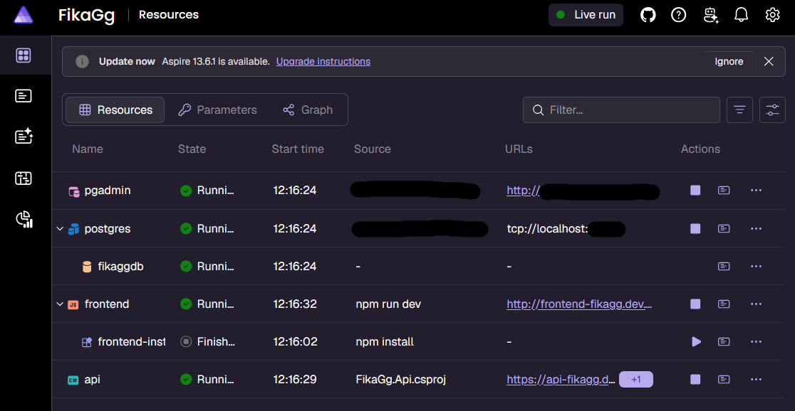

# Server Startup

1. Install [**Docker Desktop**🔗‍️](https://docs.docker.com/get-started/get-docker/)
1. Startup **Docker Desktop**.
1. In Visual Studio, press to run in `Https`.
    
    If the `Aspire.Hosting.Dcp.DcpExecutor[0]` critical error 
    appears in the terminal, you can safely ignore it.

1. Your browser will then automatically open an Aspire dashboard 
at `https://fikagg-apphost.dev.localhost:[port]/`
    
    The dashboard URL will look something like this: 
    

## Server API

To open backend server in scalar: 

1. Click on the URL on `api`.
    1. If a 404 Not Found page appears, add "scalar" at the end
    of the URL.
1. `https://api-fikagg.dev.localhost:[port]/scalar/` should be 
opened in browser.
