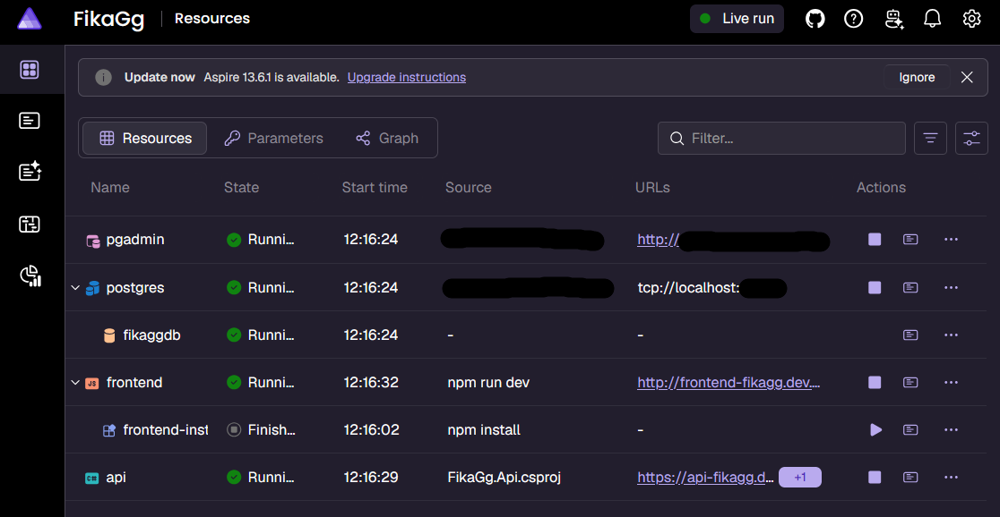
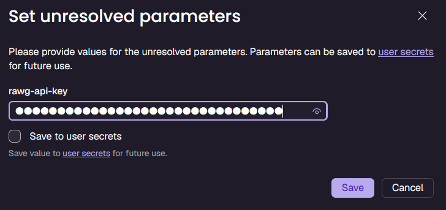
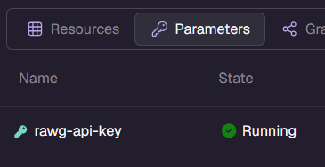
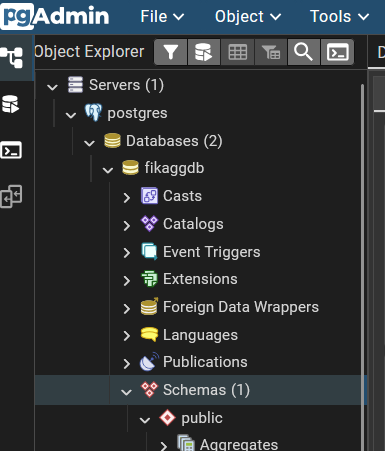
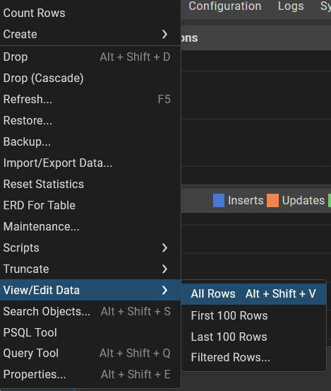

# Server Startup

## Table of Contents

- [Testing server with Aspire](#testing-server-with-aspire)
- [Testing web client](#testing-web-client)
- [Viewing database content](#viewing-database-content)

## Testing server with Aspire

1. Install [**Docker Desktop**🔗‍️](https://docs.docker.com/get-started/get-docker/)
1. Start **Docker Desktop**.
1. Start the project in Visual Studio.
    1. Ensure the **Startup profile** (dropdown menu directly to the left of the green triangle button) is set to **FikaGg.AppHost**. 
    1. Click on the green triangle button to run using `https`.
    1. If the `Aspire.Hosting.Dcp.DcpExecutor[0]` critical error shows in the terminal, you can safely ignore it.

1. Your browser will then open Aspire Dashboard.

    

1. If the server does not start, it might mean *secrets* has not been set yet.
    
    
    
    1. Check if this alert appears at the top.
    1. Press **Enter values** to open **Set unresolved parameters** window.

    
    
    1. Input the required secrets (look for them in our Discord `#secret` channel).
    1. Check **Save to user secrets** so you don't have to provide secrets each time you start Aspire. 
    1. Click **Save**.
    1. You can also see all required secrets in the "Parameters" tab.

    
    
1. You can now click on the **URLs** to test the server, web client or database.
    1. Click `pgadmin` **URL** to open database admin view.
    1. Click `frontend` **URL** to test web client.
    1. Click `api` **URL** to open up scalar API. See [Endpoint reference](../development/endpoint-reference.md) for help with testing.

## Testing web client

There might be problems with testing the web frontend. Here are a few ways to troubleshoot.

1. Write "localhost:3000" in the web address bar.
    
    The URL displayed in Aspire dashboard is different from the actual one. This is because the web client is still hard coded to `localhost:3000` (this should probably be changed so both URL match). 

1. Make sure **fika-gg-web** and **fika-gg-api** are cloned correctly. 

    Both repositories have to be located next to each other in the same parent folder (this folder can be named whatever you want). You know it's correct if a `.git/` folder can be found one layer inside their respective folder.

    ```
    📁./
    ├📁fika-gg-api/
    │ └📁.git/
    └📁fika-gg-web/
      └📁.git/
    ```
    
    The reason is because `FikaGg.Apphost/AppHost.cs` is hard coded to find the web client at this location.

## Viewing database content

1. In Aspire Dashboard, click `pgadmin` **URL** to open database admin view in a new browser tab.
1. In the Object Explorer panel, you can find all database tables under: **Servers > postgres > Databases > fikaggdb > Schemas > public > Tables**.

    

1. Right-click on a **Table** folder and click **View/Edit Data** to see its data.

    
