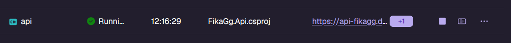
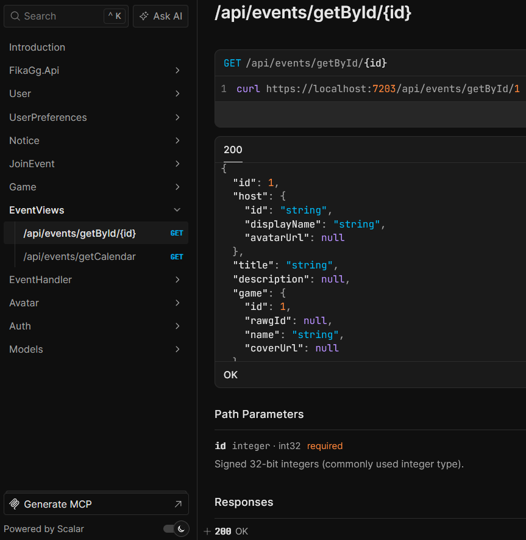

# API References

Developers sometimes need to be able to view every API endpoint so they know what to send in a request and what they'll recieve in the response.

Fortunately this project uses Scalar to generate an interactive API reference document on browser (incl. endpoints and models/DTOs).
On restart, this document will automatically match the server controllers whenever there's a change.

To view this project's implemented API references:

1. Start the server (ensure you're using `FikaGg.AppHost`).

    Example of using CLI/terminal to start.

    ```sh
    dotnet run --project src/FikaGg.AppHost
    ```

1. Aspire Dashboard should open in the web browser.
1. Click on the `api` row's URL as seen here.

    

1. A new tab should open to which will display every available API reference available in prettier way!

    
