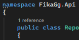
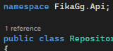
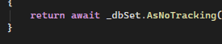
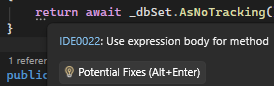
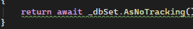
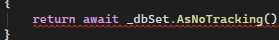

# WTF is EditorConfig?

> **WARNING!**
> Please don't edit `.editorconfig` unless the team has agreed to it. 
Changing a setting may cause side-effects in other files.

> **NOTE!** 
> If you're using Visual Studio Code, you have to download the 
[EditorConfig plugin🔗] plugin first!

[EditorConfig plugin🔗]: https://marketplace.visualstudio.com/items?itemName=EditorConfig.EditorConfig

## Table of Contents

- [Background](#background)
- [Usage](#usage)

## Background

Have you ever had this problem?

You're editing someone's code file and you realise that all TABs are two 
spaces deep, when your TABS are 4 spaces? 
And then you reformat it to be consistent with your style because your 
code editor told you to, but this caused a Git merge conflict later on?

This is what **EditorConfig** help solve! 

It provides the `.editorconfig` file which enforces a consistent coding 
style for every developer working on the same project.
The file defines rules which will override local code editor settings.

### See more

- For more details, visit [editorconfig.org🔗](https://editorconfig.org/)
    - [See editors that supports EditorConfig natively🔗](https://editorconfig.org/#pre-installed)
    - [See editors that require a plugin to use🔗](https://editorconfig.org/#download)

## Usage

EditorConfig defines coding style rules. It can define:

- Which character encoding to use.
    
    ```editorconfig
    charset = utf-8
    ```

- If pressing TAB inserts space or tab.

    ```
    indent_style = space
    indent_style = tab
    ```
- How many characters deep a TAB press is.
    
    ```
    indent_size = 4
    ```

- If spaces at the end of a line should be trimmed.

    ```
    trim_trailing_whitespace = true
    ```

- If the last line in character is 

    ```
    insert_final_newline = true
    ```

- What [end-of-line character🔗] is inserted when pressing Enter.

    ```
    end_of_line = lf     # Default to Linux and modern MacOS
    end_of_line = cr     # Default to older MacOS
    end_of_line = crlf   # Default to Windows
    ```

[end-of-line character🔗]: https://en.wikipedia.org/wiki/Newline

- If settings should apply to every file or only certain files.

    Applies to all files

    ```
    [*]
    charset = utf-8
    ```

    Applies to Program.cs file only

    ```
    [Program.cs]
    end_of_line = crlf
    insert_final_newline = true
    ```
    
    Applies to all files ending with .json, .js, .jsx, .ts, and .tsx 
    
    ```
    [*.{json,js,jsx,ts,tsx}]
    indent_style = space
    indent_size = 2
    ```

- Set Visual Studio code rules 

    ```
    csharp_style_namespace_declarations = block_scoped
    ```

    
    
    ```
    csharp_style_namespace_declarations = file_scoped
    ```

    

- Hide or show Visual Studio warnings.

    ```
    dotnet_diagnostic.IDE0022.severity = none
    ```

    
    
    ```
    dotnet_diagnostic.IDE0022.severity = suggestion
    ```

    

    ```
    dotnet_diagnostic.IDE0022.severity = warning
    ```

    

    ```
    dotnet_diagnostic.IDE0022.severity = error
    ```

    


To see all EditorConfig settings, visit [EditorConfig Wiki🔗](https://github.com/editorconfig/editorconfig/wiki/EditorConfig-Properties)
